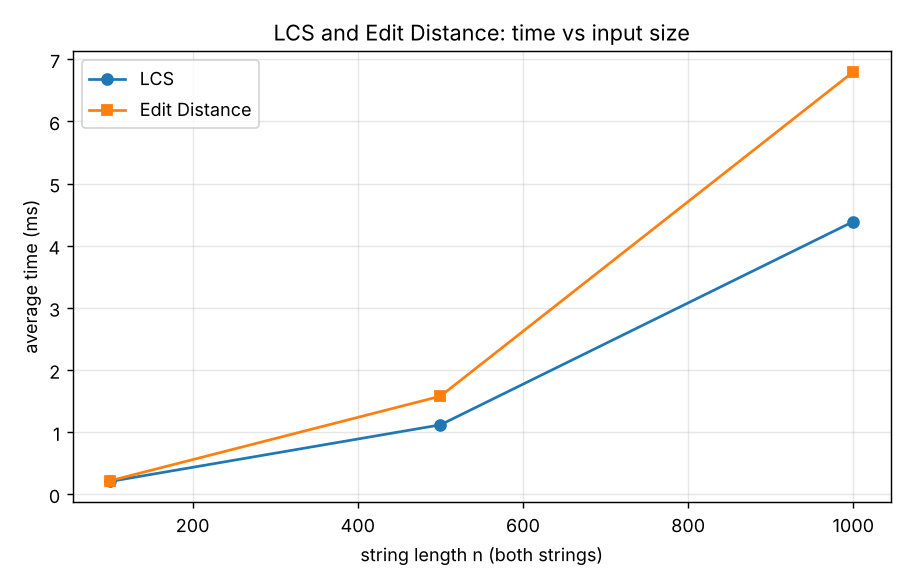
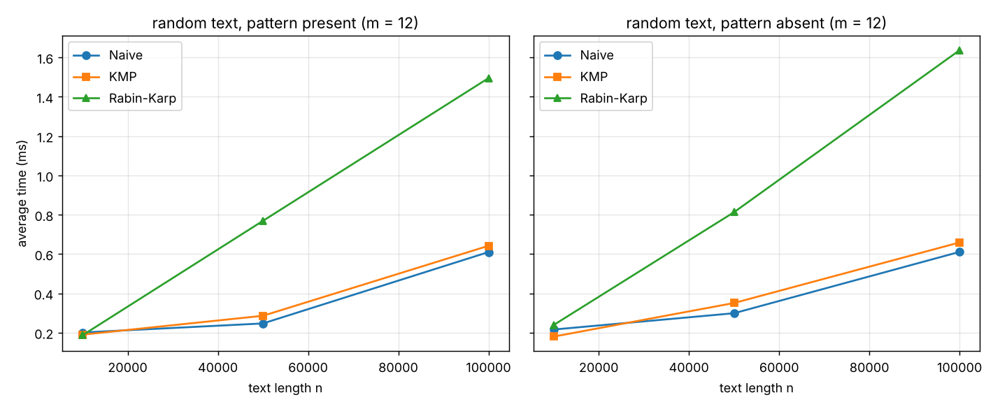
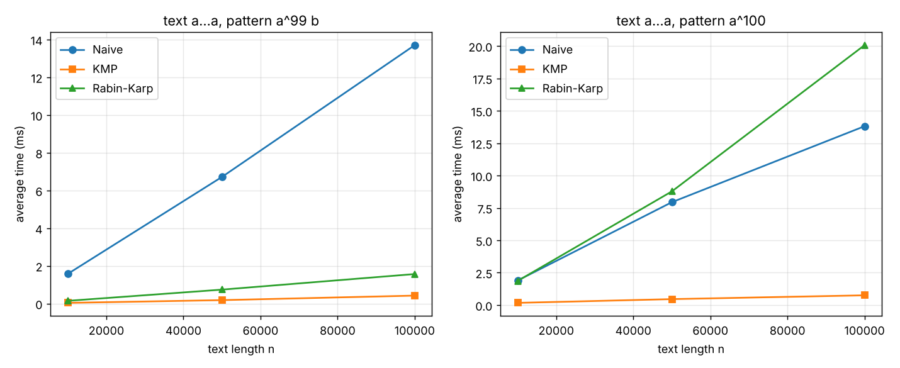
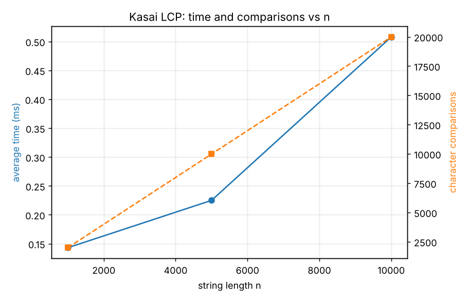

# Assignment 4 — Text Analysis: Dynamic Programming and String Algorithms

Java implementation and experimental comparison of LCS, Edit Distance, Naive / KMP / Rabin–Karp string matching and Kasai's LCP algorithm.

## How to run

Requirements: Java 17+ (tested on OpenJDK 21). Python 3 + matplotlib only for the plots.

```bash
javac -encoding UTF-8 -d out src/*.java
java -cp out Tests
java -cp out Benchmark
python3 scripts/plot_results.py
```

`Tests` prints PASS/FAIL for every check and exits with code 1 if something fails.
`Benchmark` prints the result tables and saves them to `results/*.csv`.
`plot_results.py` reads the CSV files and saves the plots to `results/plots/`.

## Project structure

```
src/
  LCS.java            Longest Common Subsequence (DP table)
  EditDistance.java   Levenshtein distance (DP table)
  NaiveSearch.java    naive string matching
  KMP.java            Knuth–Morris–Pratt with LPS table
  RabinKarp.java      Rabin–Karp with rolling hash
  Kasai.java          Kasai LCP array + simple suffix array for tests
  Tests.java          all correctness tests
  Benchmark.java      experiments, timing and operation counts
scripts/
  plot_results.py     makes the plots from the CSV files
results/
  dp.csv, matching.csv, kasai.csv
  plots/*.png
```

---

## 1. Problem description and algorithm overview

**LCS.** Given strings `a` (length n) and `b` (length m), find the length of the longest sequence of characters that appears in both strings in the same order (not necessarily next to each other). Example: LCS("ABCBDAB", "BDCABA") = 4.

**Edit Distance (Levenshtein).** The minimum number of single-character insertions, deletions and substitutions that turn `a` into `b`. Example: kitten → sitting = 3.

**String matching.** Return all starting indices where `pattern` occurs in `text`.
- Naive: try every position, compare characters left to right.
- KMP: precompute the LPS table of the pattern, then never move backwards in the text.
- Rabin–Karp: compare hashes of windows; only compare characters when hashes are equal.

**Kasai's LCP.** Given a string `s` and its suffix array `sa`, build `lcp[i]` = length of the longest common prefix of suffixes `sa[i-1]` and `sa[i]` (with `lcp[0] = 0`).

### LCS recurrence

`dp[i][j]` = LCS of the first `i` chars of `a` and the first `j` chars of `b`.

```
dp[0][j] = 0, dp[i][0] = 0
dp[i][j] = dp[i-1][j-1] + 1                  if a[i-1] == b[j-1]
dp[i][j] = max(dp[i-1][j], dp[i][j-1])       otherwise
```

Why it is correct:
- If one prefix is empty, the common subsequence is empty, so 0.
- If the last characters are equal, some optimal LCS ends with this character (if it doesn't, we can swap its last character for this one), so we take it and solve the smaller problem `dp[i-1][j-1]`.
- If they are different, at least one of the two last characters is not in the LCS, so the answer is the better of "drop the last char of `a`" and "drop the last char of `b`".
- The table is filled row by row, so every cell only uses cells that are already computed. `dp[n][m]` is the answer.

`LCS.lcsString` also walks back through the table to get one actual LCS string (used in tests).

### Edit Distance recurrence

`dp[i][j]` = edit distance between the first `i` chars of `a` and the first `j` chars of `b`.

```
dp[i][0] = i         (delete all i chars)
dp[0][j] = j         (insert all j chars)
dp[i][j] = dp[i-1][j-1]                                   if a[i-1] == b[j-1]
dp[i][j] = 1 + min(dp[i-1][j-1],  substitute
                   dp[i-1][j],    delete a[i-1]
                   dp[i][j-1])    insert b[j-1]           otherwise
```

Why it is correct: look at the last operation of an optimal edit script. The last character of `a` is either deleted, or the last character of `b` is inserted, or the two last characters are aligned (free if equal, one substitution if not). These cases cover every possibility, each one leaves a smaller subproblem, and we take the cheapest one. If the characters are equal, aligning them for free is never worse than the other options, so we can take `dp[i-1][j-1]` directly.

### How KMP avoids repeated comparisons

`lps[i]` = length of the longest proper prefix of `pattern[0..i]` that is also a suffix of it. Example: for `ababc` the LPS table is `[0, 0, 1, 2, 0]`.

When a mismatch happens after `j` matched characters, we already know the last `j` text characters are `pattern[0..j-1]`. Their longest border has length `lps[j-1]`, so we set `j = lps[j-1]` and continue from the same text position. The text index `i` never goes back. Each step either moves `i` forward or makes `j` smaller, and `j` can't decrease more times than it increased, so the search takes at most about `2n` comparisons. Naive search instead goes back and re-reads the same text characters for every shift.

### How Rabin–Karp handles hash collisions

Hash of a window: `h = (c0·B^(m-1) + c1·B^(m-2) + ... + c(m-1)) mod M` with `B = 256`, `M = 1 000 000 007`. Moving the window one step to the right removes the first char and adds a new one in O(1):

```
h = (h - text[i] * B^(m-1)) mod M
h = (h * B + text[i+m]) mod M
```

Two different strings can have the same hash (a collision). So when `windowHash == patternHash` the algorithm **always compares the window with the pattern character by character** and only adds the index if all characters match. A collision therefore only costs time, it never gives a wrong answer. The code counts `hashHits` and `collisions`. In the experiments with `M = 1e9+7` there were 0 collisions. A test uses `M = 7` on purpose: there are collisions, and the result is still correct.

### What the LCP array represents

After sorting all suffixes (suffix array), neighbouring suffixes share the longest prefixes. `lcp[i]` says how many first characters suffix `sa[i]` has in common with the previous suffix `sa[i-1]`. Examples of use: the longest repeated substring is `max(lcp)`, and the number of distinct substrings is `n(n+1)/2 - sum(lcp)`.

Example for `banana` (checked by hand):

| i | sa[i] | suffix | lcp[i] |
|---|---|---|---|
| 0 | 5 | a | 0 |
| 1 | 3 | ana | 1 |
| 2 | 1 | anana | 3 |
| 3 | 0 | banana | 0 |
| 4 | 4 | na | 0 |
| 5 | 2 | nana | 2 |

So the longest repeated substring of `banana` is `ana` (lcp = 3).

### Kasai's algorithm

1. `rank[sa[i]] = i` (position of each suffix in the sorted order).
2. Go through suffixes in text order `i = 0, 1, ..., n-1`. Compare suffix `i` with the suffix before it in sorted order, `j = sa[rank[i]-1]`, starting from `h` already known characters.
3. Save `lcp[rank[i]] = h`, then decrease `h` by 1 for the next suffix.

Key fact: if suffix `i` has LCP `h` with its neighbour, then suffix `i+1` has LCP at least `h-1` with its neighbour (drop the first character of both). So we never start from 0 again.

---

## 2. Implementation decisions and assumptions

- Plain Java, no Maven, no external libraries. Each algorithm is a class with static methods, so it is easy to call from tests and benchmark.
- All search methods return `List<Integer>` with **all** starting indices in increasing order, including overlapping ones (`"aaaaa"`, `"aa"` → `[0, 1, 2, 3]`).
- **Empty pattern:** returns an empty list (we treat it as "nothing to search for"). This is the same for all three algorithms and is tested.
- **Pattern longer than text:** returns an empty list.
- LCS and Edit Distance use the full `(n+1) × (m+1)` table. It is simple and allows reconstructing the answer. Only the length / distance is required, so a 2-row version would also work with O(min(n, m)) memory, but I kept the full table for clarity.
- Rabin–Karp: base 256, modulus 1 000 000 007 (prime). All arithmetic is in `long`, so there is no overflow (`MOD * 256 < 2^63`).
- Suffix array: built with a simple sort of suffix indices using a char-by-char comparator (`Kasai.buildSuffixArray`). This is only a helper for tests and benchmark and it is **not** timed. Expected suffix arrays for `banana` and `mississippi` are written by hand in the tests.
- Operation counters are public static fields (`cells`, `comparisons`, `hashHits`, `collisions`). They are reset before a counted run.

---

## 3. Complexity analysis

n = text / first string length, m = pattern / second string length.

| Algorithm | Main operation / recurrence | Best case time | Worst case time | Auxiliary space | Justification |
|---|---|---|---|---|---|
| LCS | `dp[i][j] = dp[i-1][j-1]+1` or `max(dp[i-1][j], dp[i][j-1])` | Θ(n·m) | Θ(n·m) | Θ(n·m) | Every one of the n·m cells is filled exactly once in O(1). No early exit, so best = worst. Table has (n+1)(m+1) ints. |
| Edit Distance | `dp[i][j] = dp[i-1][j-1]` or `1 + min(sub, del, ins)` | Θ(n·m) | Θ(n·m) | Θ(n·m) | Same as LCS: n·m cells, O(1) each, plus O(n+m) for the base row and column. |
| Naive matching | compare `text[i+j]` with `pattern[j]` for every shift `i` | Θ(n) (first char mismatches every time) | Θ((n−m+1)·m) | Θ(1) (+ output list) | n−m+1 shifts, each compares from 1 up to m chars. Worst case: `a...a` and `a..ab`. |
| KMP | LPS: `lps[i]` = longest border; search: on mismatch `j = lps[j-1]` | Θ(m) preprocessing + Θ(n) search | Θ(m) preprocessing + Θ(n) search, total Θ(n+m) | Θ(m) for LPS | Text index never goes back; every comparison either moves `i` forward or decreases `j`, so ≤ 2n comparisons in search and ≤ 2m in preprocessing. |
| Rabin–Karp | rolling hash `h = (h − c·B^(m−1))·B + c'` mod M, verify on hash hit | Θ(m) preprocessing + Θ(n) search | Θ(n·m) | Θ(1) (+ output list) | Each window hash update is O(1). Expected time Θ(n+m) when there are few hash hits. Worst case: every window hits (many matches like `a...a`/`a^m`, or many collisions), each needs m comparisons. |
| Kasai LCP | `lcp[rank[i]] = h`, then `h--` for the next suffix | Θ(n) | Θ(n) | Θ(n) (`rank` array + `lcp` output) | `h` is decreased at most n times and never exceeds n, so it is increased at most 2n times in total. Each loop step does one mismatching comparison at most → ≤ ~3n comparisons, Θ(n). |

**Expected vs worst case.** Rabin–Karp is the only algorithm here where the expected and worst-case bounds differ. With a large prime modulus the chance that a wrong window has the same hash is about 1/M, so the expected number of character comparisons is only m per real match, and the expected time is Θ(n + m + m·(number of matches)). In the worst case (every window is a hash hit) it becomes Θ(n·m), the same as naive search. Naive search also has a good average case on random text (see experiments), but its worst case is Θ(n·m). KMP is Θ(n+m) always.

**Theory vs measurement.** The table above is about the number of steps, which does not depend on the computer. Measured time (section 6) also depends on the JIT, cache, the cost of `%` operations etc., so it is only expected to follow the same *shape* (linear, quadratic), not exact numbers.

---

## 4. Testing strategy and results

`Tests.java` is a simple test runner with a `check(condition, name)` method. Result: **82 checks passed, 0 failed.**

| Group | What is tested |
|---|---|
| LCS (10) | identical strings, completely different strings, first / second / both empty, ABCBDAB vs BDCABA = 4, AGGTAB vs GXTXAYB = 4 and the actual LCS string `GTAB`, one-character cases |
| Edit Distance (10) | identical strings (0), one empty string (3), both empty, one substitution (cat→cut), one insertion (cat→cart), one deletion (cart→cat), kitten→sitting = 3, sunday→saturday = 3, all different |
| String matching (53) | pattern at beginning, middle, end; multiple occurrences; overlapping occurrences; pattern absent; pattern longer than text; empty pattern; empty text; pattern equals text; KMP fallback case `ababcabab`/`abab`; repeated prefix `aaaaab`/`aab`. **For each case all three algorithms are checked against the expected list and against each other.** Plus 200 random texts/patterns (fixed seed) where Naive, KMP and Rabin–Karp must return the same list. |
| Rabin–Karp collisions (2) | with modulus 7 there are hash collisions (`collisions > 0`), and the result is still equal to the naive result |
| Kasai (7) | suffix array and LCP of `banana` and `mississippi` (written by hand), one-character string, `aaaa`, plus 50 random strings where Kasai is compared with a slow direct LCP computation |

Manually verified example for `mississippi`:
`sa = [10, 7, 4, 1, 0, 9, 8, 6, 3, 5, 2]`, `lcp = [0, 1, 1, 4, 0, 0, 1, 0, 2, 1, 3]` (e.g. `issippi` and `ississippi` share `issi` → 4).

---

## 5. Experimental setup

- Machine: Linux x86-64, OpenJDK 21, default JVM settings.
- **Alphabet:** `{a, b, c, d}` (4 letters) for all random strings. A small alphabet gives more partial matches, so the difference between algorithms is easier to see.
- **Random seed:** `42 + n` for each input size (`java.util.Random`), so results are reproducible.
- **Input sizes** (as required):

| Experiment | Sizes |
|---|---|
| LCS | two random strings of length 100, 500, 1000 |
| Edit Distance | the same two strings as LCS |
| String matching | random text of length 10 000, 50 000, 100 000 |
| Kasai | random string of length 1000, 5000, 10 000 |

- **String matching patterns (m = 12):**
  - *present*: the 12 characters starting at position n/2 of the text,
  - *absent*: random 12-character string, regenerated until it does not occur in the text.
  - The same text and pattern are used for Naive, KMP and Rabin–Karp.
- Extra worst-case inputs (to compare with theory): text = `a` repeated n times with pattern `a^99 b` (absent) and `a^100` (present everywhere).

**Timing methodology**
- `System.nanoTime()` around only the algorithm call.
- 20 warm-up runs (not measured) so that the JIT compiles the code first, then **5 measured runs, average reported** (in ms).
- Input generation, suffix array construction, printing and writing CSV files are outside the timed region.
- Results are added to a `sink` variable and printed at the end, so the JIT cannot remove the calls.
- Operation counts are taken in a separate run (counters reset before it): DP cells filled, character comparisons, Rabin–Karp hash hits and collisions, Kasai character comparisons.

---

## 6. Results

### LCS and Edit Distance

| n = m | LCS time (ms) | LCS cells | LCS length | Edit time (ms) | Edit cells | Edit distance |
|---|---|---|---|---|---|---|
| 100 | 0.205 | 10 000 | 61 | 0.216 | 10 000 | 56 |
| 500 | 1.116 | 250 000 | 320 | 1.577 | 250 000 | 262 |
| 1000 | 4.388 | 1 000 000 | 647 | 6.798 | 1 000 000 | 524 |



### String matching (random text, m = 12)

| case | n | found | Naive ms | Naive cmp | KMP ms | KMP cmp | RK ms | RK cmp | RK hash hits | RK collisions |
|---|---|---|---|---|---|---|---|---|---|---|
| present | 10 000 | 1 | 0.201 | 13 419 | 0.190 | 12 521 | 0.187 | 12 | 1 | 0 |
| absent | 10 000 | 0 | 0.216 | 13 322 | 0.180 | 12 446 | 0.239 | 0 | 0 | 0 |
| present | 50 000 | 1 | 0.247 | 66 683 | 0.286 | 61 823 | 0.769 | 12 | 1 | 0 |
| absent | 50 000 | 0 | 0.299 | 66 485 | 0.351 | 62 425 | 0.813 | 0 | 0 | 0 |
| present | 100 000 | 1 | 0.610 | 132 916 | 0.642 | 124 688 | 1.495 | 12 | 1 | 0 |
| absent | 100 000 | 0 | 0.611 | 133 292 | 0.659 | 125 012 | 1.637 | 0 | 0 | 0 |

(KMP comparisons include the 11–22 comparisons of LPS preprocessing. RK "cmp" counts only character comparisons after a hash hit.)



### String matching, worst-case inputs (text = a…a, m = 100)

| case | n | found | Naive ms | Naive cmp | KMP ms | KMP cmp | RK ms | RK cmp | RK hash hits |
|---|---|---|---|---|---|---|---|---|---|
| pattern a^99 b | 10 000 | 0 | 1.576 | 990 100 | 0.037 | 20 098 | 0.145 | 0 | 0 |
| pattern a^99 b | 50 000 | 0 | 6.716 | 4 990 100 | 0.182 | 100 098 | 0.739 | 0 | 0 |
| pattern a^99 b | 100 000 | 0 | 13.702 | 9 990 100 | 0.422 | 200 098 | 1.565 | 0 | 0 |
| pattern a^100 | 10 000 | 9 901 | 1.896 | 990 100 | 0.168 | 10 099 | 1.866 | 990 100 | 9 901 |
| pattern a^100 | 50 000 | 49 901 | 7.940 | 4 990 100 | 0.457 | 50 099 | 8.774 | 4 990 100 | 49 901 |
| pattern a^100 | 100 000 | 99 901 | 13.807 | 9 990 100 | 0.751 | 100 099 | 20.065 | 9 990 100 | 99 901 |



### Kasai's LCP

| n | time (ms) | char comparisons | comparisons / n | max LCP |
|---|---|---|---|---|
| 1000 | 0.143 | 1 990 | 1.99 | 9 |
| 5000 | 0.225 | 9 991 | 2.00 | 12 |
| 10 000 | 0.508 | 19 989 | 2.00 | 13 |



Raw data: `results/dp.csv`, `results/matching.csv`, `results/kasai.csv`.

---

## 7. Discussion: theory vs experiment

**LCS and Edit Distance.** The number of cells is exactly n² (10 000 → 250 000 → 1 000 000), as the Θ(n·m) analysis says. Time also grows about quadratically: from 500 to 1000 (2× the size) LCS time grows 3.9× and Edit Distance 4.3×, close to the expected 4×. From 100 to 500 the growth is smaller than 25× because at n = 100 the run is very short and fixed costs (allocating the table) are a big part of it. Edit Distance is about 1.5× slower than LCS with the same number of cells, because each mismatch cell computes a 3-way minimum instead of one `max`. Big-O is the same, the constant is different.

**String matching on random text.** All three are linear here. On a 4-letter alphabet the naive algorithm almost always fails after the first one or two characters: expected comparisons per shift are 1 + 1/4 + 1/16 + … ≈ 4/3, and the measured value is 133 292 / 100 000 ≈ 1.33. So on random text the naive worst case Θ(n·m) never happens, and naive search is as fast as KMP (or faster, because its loop is simpler). KMP does ~1.25 comparisons per character, slightly fewer than naive. Rabin–Karp does almost no character comparisons (only 12 for the one real match), but it is the **slowest** in time: every step does a few multiplications and `%` operations on `long`, which cost more than one `char` comparison. This shows clearly that comparison count is not the same as running time.

**Worst-case inputs.** Here the theory is visible directly:
- Naive does exactly (n − m + 1)·m comparisons (100 · 99 901 = 9 990 100 for n = 100 000), Θ(n·m), and is about 30× slower than KMP.
- KMP does ≤ 2n comparisons (200 098 for n = 100 000), Θ(n+m), and stays under 1 ms.
- Rabin–Karp with `a^99 b` has no hash hits, so it is linear. But with `a^100` every window is a real match, every hash hit is verified with m comparisons, and it becomes Θ(n·m) like naive (same 9 990 100 comparisons) and even slower in time because of the hashing on top. This is the difference between Rabin–Karp's expected Θ(n+m) and worst-case Θ(n·m).
- Hash collisions: 0 in all experiments with M = 1e9+7, as expected (probability about 1/M per window).

**Kasai.** Comparisons are almost exactly 2n (1.99–2.00 per character), which matches the Θ(n) bound (≤ 2n increments of `h` plus mismatches). Time is very small (< 1 ms for n = 10 000) and grows roughly linearly; the 1000 → 5000 step is less than 5× because the smallest run is dominated by fixed costs and timer noise. Max LCP on random 4-letter strings is small (9–13, about 2·log₄ n), which is why the actual work is so low.

**General.** Operation counts match the theoretical formulas exactly. Times follow the same growth shape but have different constants because of hashing cost, branches, memory (DP tables of 1 001 × 1 001 ints ≈ 4 MB) and JIT. For very small inputs time is noisy, so counts are more reliable there.

---

## 8. Conclusion

- **LCS vs Edit Distance:** both are Θ(n·m) time and (in this version) Θ(n·m) memory. They are simple and always exact, but quadratic, so they are fine for strings of a few thousand characters, not for very long texts. If only the value is needed, memory can be reduced to two rows.
- **Naive:** simplest code, no preprocessing, no extra memory, and fast on random text. But it has no guarantee: on repetitive text it becomes Θ(n·m).
- **KMP:** guaranteed Θ(n+m) for every input, with only Θ(m) extra memory. Best choice when the input can be repetitive or adversarial. The cost is the LPS table and slightly more complex code.
- **Rabin–Karp:** expected Θ(n+m), very few character comparisons, and the hash idea extends to many patterns at once. But hashing is expensive per character, the worst case is Θ(n·m), and correctness depends on always verifying hash hits.
- **Kasai:** builds the LCP array in Θ(n) from a suffix array and turns it into a strong tool (longest repeated substring, number of distinct substrings). The main cost is building the suffix array itself, which is not part of Kasai.

Main trade-off: simple algorithms (naive, full DP table) are easy and often fast enough on random data, while KMP and Kasai give guaranteed linear bounds; Rabin–Karp trades a worse worst case for a simple hashing idea with good expected behaviour.
